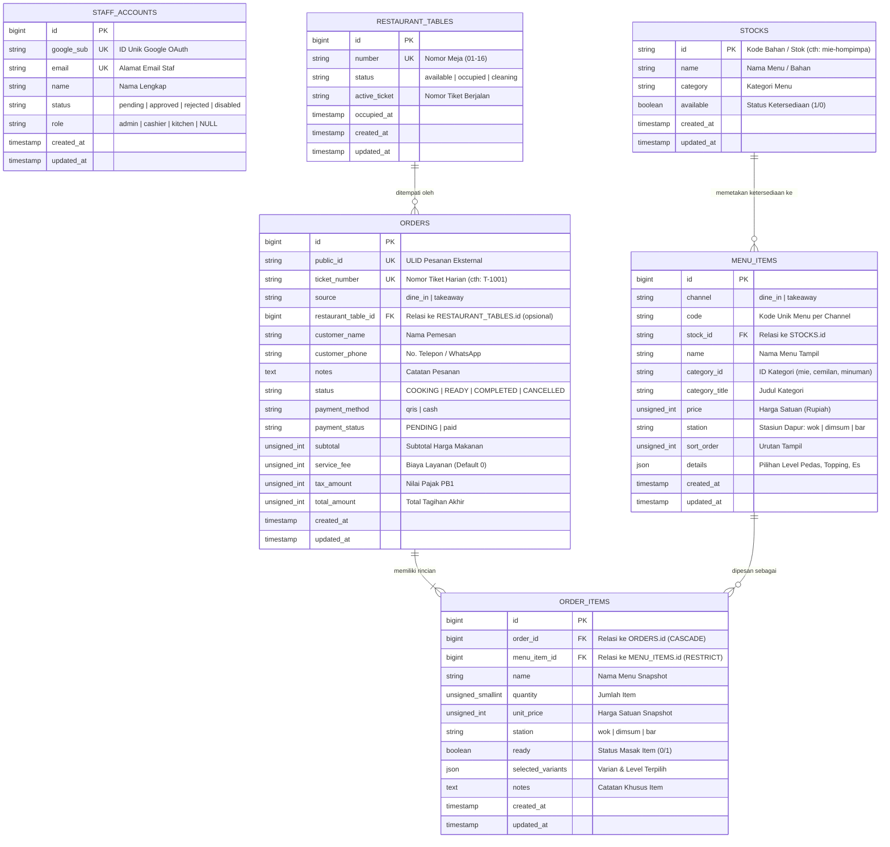

# Entity Relationship Diagram (ERD) & Skema Database
## Sistem Restoran "Mie Elon Musk" (MariaDB / MySQL XAMPP)

**Nama Database:** `mie_elon_musk`  
**Collation:** `utf8mb4_unicode_ci`  
**Sumber Kebenaran:** Migrasi Laravel di `backend/database/migrations/`

---

## 1. Diagram Relasi Entitas (Mermaid Text & Visual Map)

---

## 2. Kamus Data & Integritas Tabel (Data Dictionary)

### 2.1 `staff_accounts`
Menyimpan identitas staf terverifikasi Google dan status persetujuan hak akses.
- **`google_sub`**: Primary Sub ID dari Google OAuth (Unique).
- **`status`**: Menentukan otorisasi akses (`pending` = dilarang, `approved` = diizinkan).
- **`role`**: Peran staf (`admin`, `cashier`, `kitchen`).

### 2.2 `stocks` & `menu_items`
- Pemisahan fisik antara ketersediaan bahan dapur (`stocks`) dan item katalog jual (`menu_items`).
- Ketika Admin mengubah stok `mie-hompimpa` menjadi Habis (`available = 0`), seluruh menu item di channel `dine_in` dan `takeaway` yang mereferensikan `stock_id` tersebut otomatis berstatus habis di UI pelanggan.

### 2.3 `orders` & `order_items`
- Menyimpan snapshot harga (`unit_price`) saat transaksi dibuat, agar riwayat pesanan masa lalu tidak berubah jika di kemudian hari ada kenaikan harga menu.
- Relasi `order_items.order_id` menggunakan `ON DELETE CASCADE`.
- Indeks komposit pada `(status, created_at)` untuk mengoptimalkan kueri performa filter pesanan dapur dan laporan penjualan admin.
