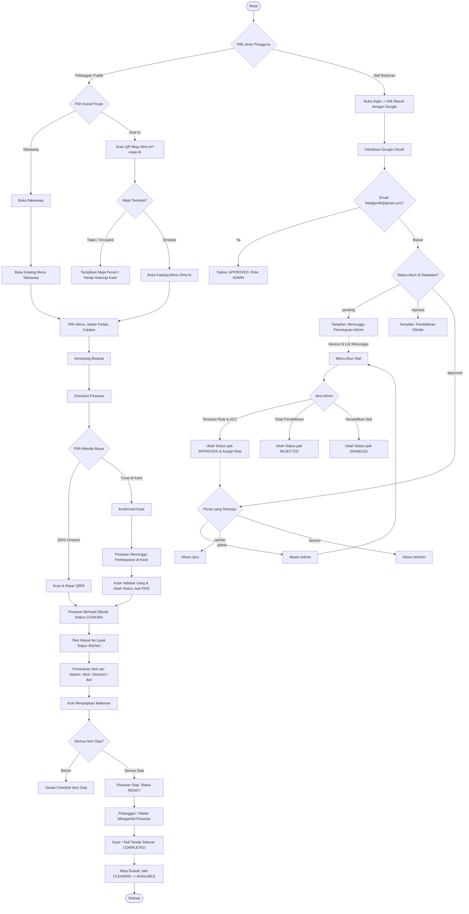
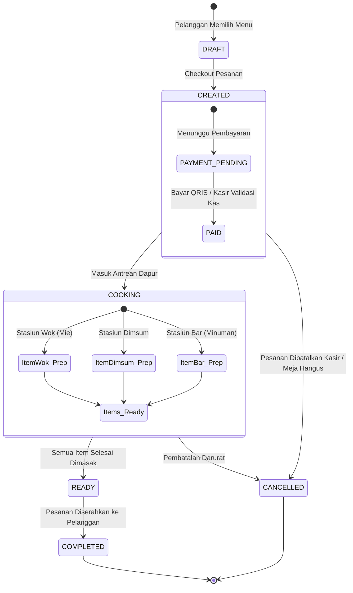
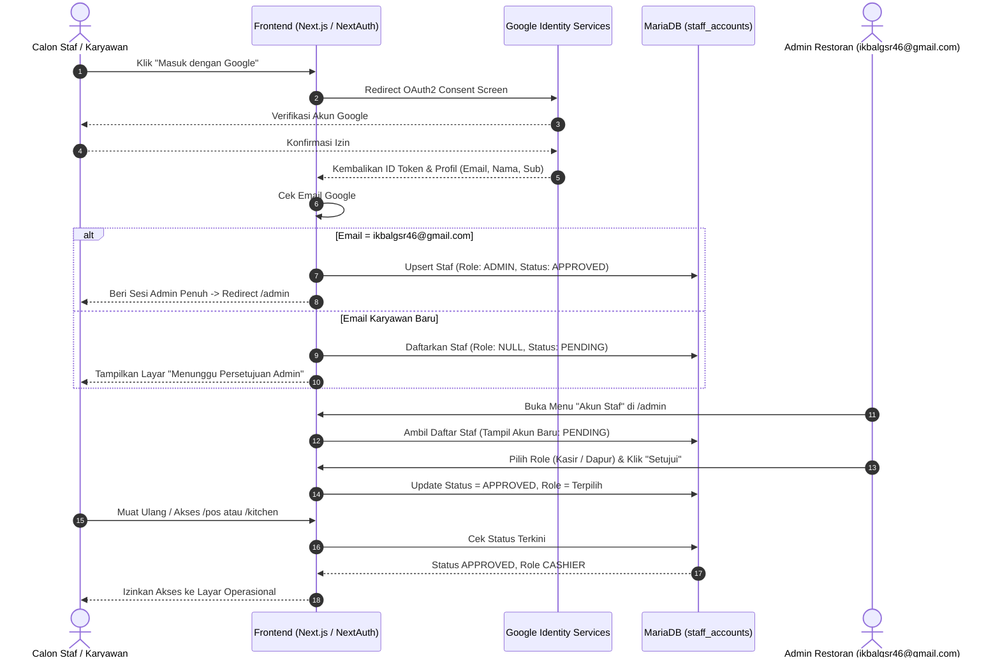

# Master Flowchart Sistem Restoran "Mie Elon Musk"
Dokumentasi alur komprehensif seluruh sistem: Kanal Pelanggan, Kasir, Dapur, Admin, dan Autentikasi Google Staf.

---

## 1. Flowchart End-to-End Sistem Keseluruhan

---

## 2. Alur Transaksi & State Machine Pesanan (Order State Lifecycle)

---

## 3. Alur Verifikasi Google OAuth & Keamanan HMAC Antar Layanan

