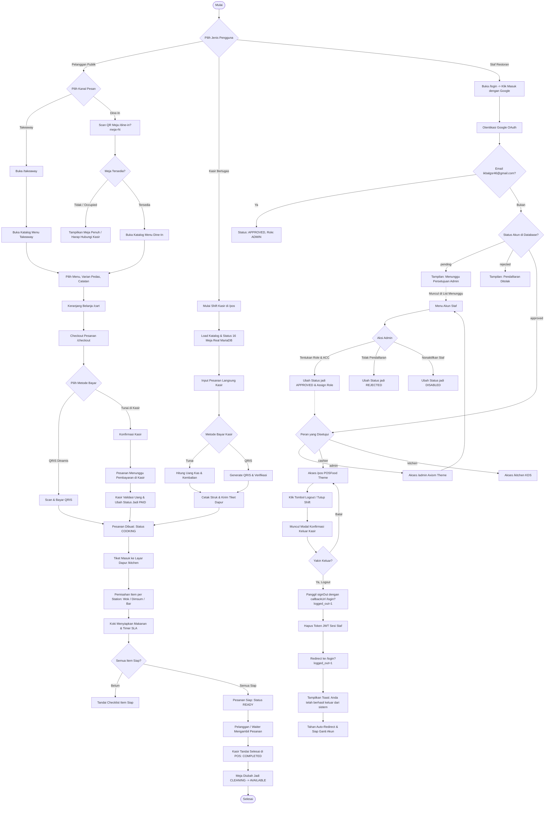
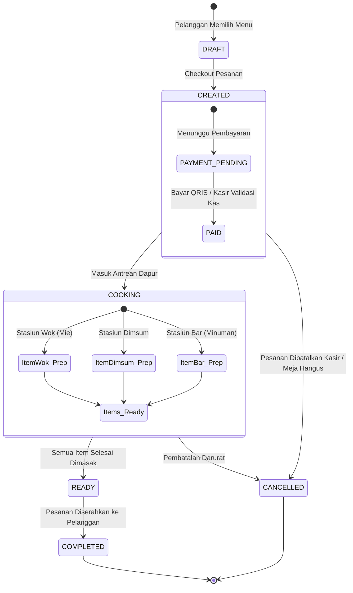
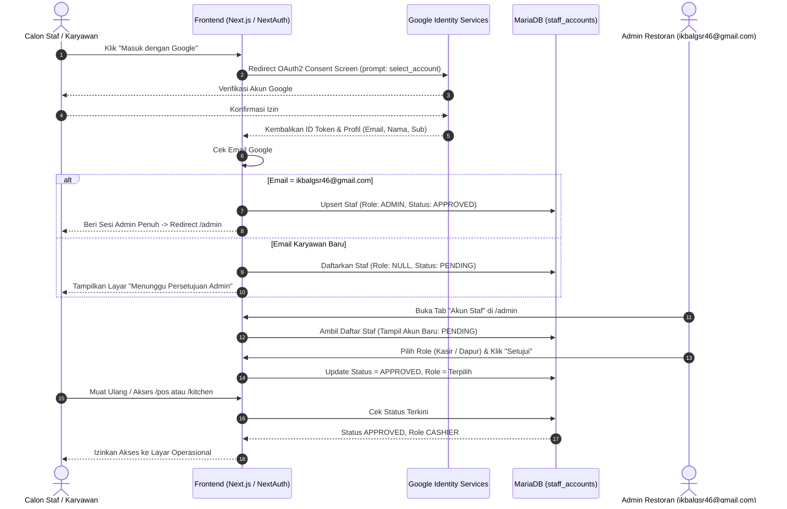
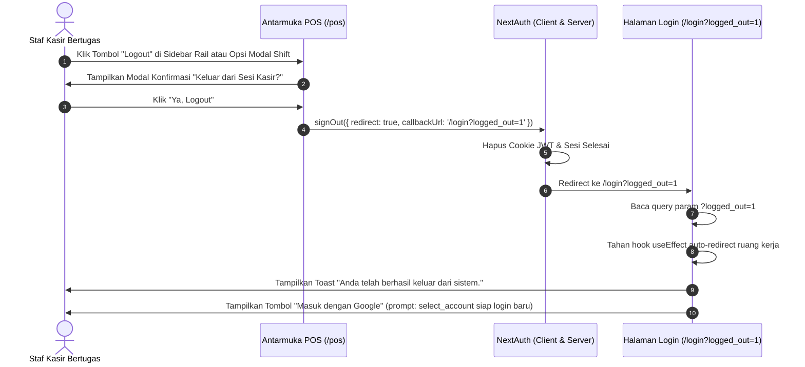

# Master Flowchart Sistem Restoran "Mie Elon Musk"
Dokumentasi alur komprehensif seluruh sistem: Kanal Pelanggan, Kasir POS, Layar Dapur, Dashboard Admin, Autentikasi Staf Google OAuth, dan Alur Logout Aman.

---

## Berkas Grafis & Dokumen Cetak

Diagram alur resmi sistem telah dikompilasi ke dalam format resolusi tinggi:
- **Gambar PNG (300 DPI):** `docs/flowchart/Flowchart_Sistem_Mie_Elon_Musk.png`
- **Dokumen PDF (Siap Cetak):** `docs/flowchart/Flowchart_Sistem_Mie_Elon_Musk.pdf`

---

## 1. Flowchart End-to-End Sistem Keseluruhan

---

## 2. Alur Transaksi & State Machine Pesanan (Order State Lifecycle)

---

## 3. Alur Verifikasi Google OAuth & Keamanan HMAC Antar Layanan

---

## 4. Alur Logout Kasir Aman & Pemutusan Sesi Bebas Redirect-Loop

---

## 5. Legenda Simbol Flowchart Standar ISO 5807

| Simbol | Nama | Definisi & Penggunaan dalam Sistem |
| :---: | :--- | :--- |
| ⬭ | **Terminator (Oval)** | Titik awal (*Start/Mulai*) atau titik akhir (*End/Selesai*) dari suatu alur operasional. |
| ▭ | **Process (Persegi)** | Operasi komputasi atau tindakan sistem otomatis (misal: validasi meja, kalkulasi pesanan). |
| ⬦ | **Decision (Belah Ketupat)** | Titik evaluasi kondisi logis atau percabangan keputusan (misal: Cek Status Meja, Metode Bayar). |
| ▱ | **Data / Input-Output (Jajar Genjang)** | Tindakan masukan pengguna atau luaran data (misal: Scan QR, Masuk dengan Google, Input Uang Tunai). |
| ⟶ | **Flow Line (Panah)** | Menunjukkan urutan eksekusi langkah dan relasi ketergantungan antar-proses. |
| ╌> | **Dashed Flow Line** | Alur kembali (*loop-back*) atau efek tidak langsung setelah aksi persetujuan admin. |
