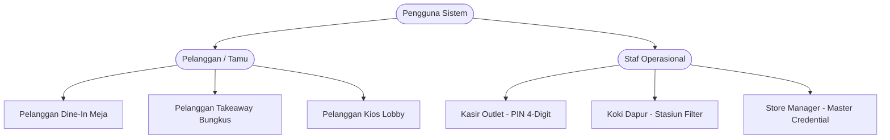

# SOFTWARE REQUIREMENTS SPECIFICATION (SRS)
## Omnichannel Restaurant Operating System (ROS) — Mie Elon Musk
**Document Code:** SRS-MEM-2026-V1.0  
**Version:** 1.0 (Production Standard)  
**Author:** Lead Systems Architect & Senior Software Engineering Team  
**Date:** 21 Oktober 2026  
**Status:** Approved for Implementation & Operations  

---

## 1. PENDAHULUAN (INTRODUCTION)

### 1.1 Tujuan Dokumen (Purpose)
Dokumen Software Requirements Specification (SRS) ini merinci seluruh spesifikasi fungsional (*Functional Requirements* / FR) dan non-fungsional (*Non-Functional Requirements* / NFR) untuk pembangunan dan operasional **Ekosistem Omnichannel Restaurant Operating System (ROS) Mie Elon Musk**. Dokumen ini menjadi acuan baku bagi seluruh tim teknis (*Frontend, Backend, QA, DevOps/Infra*), operasional lapangan (*Store Manager, Kasir, Koki Dapur*), dan manajemen eksekutif.

### 1.2 Ruang Lingkup Sistem (System Scope)
Sistem ini mengintegrasikan seluruh titik interaksi pelanggan dan staf ke dalam satu arsitektur terpusat (*Omnichannel*) yang meliputi **7 Portal Resmi**:
1. **Public Showcase & Menu Navigation:** `/`
2. **Customer Dine-In (QR Meja):** `/dine-in`
3. **Customer Takeaway (Bungkus Mandiri):** `/takeaway`
4. **Self-Service Kiosk Lobby:** `/kios`
5. **Point of Sale (POS) Kasir Desktop:** `/kasir`
6. **Kitchen Display System (KDS) Terminal Dapur:** `/dapur`
7. **Store Manager Hub & Control Center:** `/manager`

---

## 2. PENGGUNA SISTEM (USER PERSONAS & RBAC)

| ID Aktor | Nama Peran | Level Hak Akses | Lingkungan Kerja | Batasan Keamanan |
|---|---|---|---|---|
| **ACT-01** | **Pelanggan Dine-In** | 100% Guest (Tanpa Login) | HP Pribadi (QR Meja) | Terikat nomor meja pada URL parameter (`?meja=XX`). |
| **ACT-02** | **Pelanggan Takeaway** | 100% Guest (Zero-Data) | HP Pribadi (Mobile Web) | Hanya input nama panggilan singkat; no WhatsApp opsional & di-mask. |
| **ACT-03** | **Pelanggan Kios Lobby** | Kios Attract Touchscreen | Layar Sentuh 24"+ Lobby | Auto-reset ke screensaver jika tidak tersentuh selama 10 detik. |
| **ACT-04** | **Kasir POS** | Operator POS Staf | Desktop / Laptop Kasir | Akses transaksi tunai, cetak struk, kalkulasi kembalian. |
| **ACT-05** | **Koki Dapur (Cook)** | Operator KDS Dapur | Layar Wall / Tablet Dapur | Hanya aksi checklist item, filter stasiun, dan tombol bump `SELESAI`. |
| **ACT-06** | **Store Manager** | Supervisor Toko | Tablet / Desktop Manager | Akses penuh saklar darurat stok habis, denah meja, dan laporan omzet. |

---

## 3. PERSYARATAN FUNGSIONAL (FUNCTIONAL REQUIREMENTS)

### 3.1 Modul Pemesanan Pelanggan (Customer Ordering)
* **FR-ORD-01 (Auto-Lock Meja):** Sistem wajib otomatis mendeteksi nomor meja dari parameter URL (`/dine-in?meja=7`) dan menguncinya pada transaksi.
* **FR-ORD-02 (Kustomisasi Menu):** Sistem wajib mendukung kustomisasi level pedas (Level 0 - 8), jenis dimsum (Goreng / Kukus), dan varian minuman tanpa delay.
* **FR-ORD-03 (Zero-Friction Checkout):** Pelanggan tidak boleh dipaksa membuat akun, memasukkan password, atau verifikasi OTP SMS yang dapat memicu *cart abandonment*.
* **FR-ORD-04 (Tracking Real-Time):** Setelah checkout, layar HP pelanggan wajib menampilkan pelacakan 3 tahap (*Diterima, Dimasak, Siap Diantar*) dan breakdown stasiun dapur secara real-time.

### 3.2 Modul Kios Mandiri Lobby
* **FR-KIO-01 (Attract Screensaver):** Sistem wajib otomatis menampilkan animasi promosi screensaver saat mesin tidak digunakan. Sentuhan pertama langsung mengaktifkan antarmuka pemesanan.
* **FR-KIO-02 (Simulasi Pembayaran QRIS & Tiket):** Kios menyajikan QRIS dinamis dan mencetak tiket antrean kode `K-[Nomor]` dengan estimasi waktu masak.
* **FR-KIO-03 (Auto-Reset Inactivity):** Kios wajib me-reset antarmuka kembali ke kondisi awal jika pelanggan meninggalkan mesin setelah transaksi selesai (countdown 10 detik).

### 3.3 Modul POS Kasir Desktop
* **FR-POS-01 (3-Column Rapid POS):** Layout kasir wajib memisahkan Kategori (Kiri), Menu Grid (Tengah), dan Struk Kalkulasi Aktif (Kanan) sesuai standar GoMeal.
* **FR-POS-02 (Quick Tender Buttons):** Kasir wajib memiliki tombol pecahan uang cepat (*Uang Pas, Rp50.000, Rp100.000*) dengan kalkulasi kembalian otomatis instan.
* **FR-POS-03 (Cetak Struk Resmi):** Kasir mencetak struk fisik bernomor kode `C-[Nomor]` dan secara instan mengirim pesanan ke antrean dapur.

### 3.4 Modul KDS Layar Dapur (Kitchen Display System)
* **FR-KDS-01 (Multi-Channel Ingestion):** Layar dapur wajib menerima dan menampilkan pesanan dari 4 channel sekaligus (*Dine-In, Takeaway, Kios, Kasir*) dalam urutan First-In First-Out (FIFO).
* **FR-KDS-02 (Filter Stasiun Kerja):** Koki dapat menyaring tiket berdasarkan stasiun: `Semua Menu`, `Wok Mie (Lv 0-8)`, `Dimsum Fryer/Kukus`, dan `Bar Minuman`.
* **FR-KDS-03 (SLA Timer Alerts):** Durasi masak wajib dihitung per detik dengan indikator warna visual:
  - **Hijau (< 6 menit):** Masak aman sesuai standar.
  - **Kuning (6 - 12 menit):** Perhatian, mendekati batas waktu toleransi.
  - **Merah (> 12 menit):** SLA Terlambat (Overdue Alert)! Kartu berkedip dan menuntut prioritas koki.
* **FR-KDS-04 (Web Audio Bell Chime):** Saat ada pesanan baru masuk atau pesanan selesai, sistem wajib membunyikan audio chime synthesizer Web Audio API.
* **FR-KDS-05 (Bump Bar Action):** Tombol `[SELESAI MASAK • PANGGIL]` wajib mengubah status tiket menjadi `READY` dan langsung memperbarui status di HP pelanggan pemesan.

### 3.5 Modul Manager Hub
* **FR-MGR-01 (Emergency Sold-Out Switch):** Manager dapat mematikan ketersediaan menu secara mendadak. Menu yang dimatikan seketika tidak dapat dipesan di Dine-In, Takeaway, Kios, dan Kasir.
* **FR-MGR-02 (Interactive Table Map):** Menampilkan denah meja restoran dengan status warna (*Hijau: Kosong, Merah: Terisi + Nomor Tiket, Kuning: Perlu Dibersihkan*).
* **FR-MGR-03 (Daily Sales Reporting):** Menyajikan ringkasan omzet harian kotor, bersih, potongan diskon, dan volume transaksi per channel.

---

## 4. PERSYARATAN NON-FUNGSIONAL (NON-FUNCTIONAL REQUIREMENTS)

### 4.1 Performa & Latensi (Performance & Latency)
* **NFR-PERF-01:** Waktu pembaruan data antara aksi dapur (*bump*) ke layar pelanggan tidak boleh melebihi **2.000 milidetik (2 detik)** menggunakan Smart Polling.
* **NFR-PERF-02:** Response time seluruh Next.js API Handlers (`/api/orders`, `/api/stock`, `/api/tables`) wajib berada di bawah **50 ms** untuk in-memory operations.
* **NFR-PERF-03:** Bundle size client pages mobile wajib dioptimasi dengan teknik lazy loading / Next.js dynamic chunks agar dapat dibuka lancar di jaringan 4G/3G pelanggan.

### 4.2 Privasi Data & Perlindungan Pelanggan (Data Privacy & Security)
* **NFR-SEC-01 (Zero-Data Policy):** Pelanggan tidak diwajibkan memberikan data sensitif (nama lengkap, tanggal lahir, password).
* **NFR-SEC-02 (WhatsApp Masking Protection):** Jika pelanggan meminta nota digital via nomor WA, nomor telepon di layar staf wajib disensor (*masked*): `0812-****-8821` guna mencegah penyalahgunaan data atau kontak oleh kru outlet.
* **NFR-SEC-03 (Local Device Session):** Tiket pelacakan pesanan disimpan di URL state (`?ticket=D-07-06`) dan browser local session, sehingga jika pelanggan me-refresh browser HP, status pesanan tidak hilang.

### 4.3 Keandalan & Ketahanan (Reliability & Resilience)
* **NFR-REL-01 (Zero Auto-Pause Database):** Database menggunakan arsitektur MySQL Cloud / Prisma yang **tidak pernah di-pause otomatis oleh vendor cloud**, menjamin uptime 99.9%.
* **NFR-REL-02 (No 24/7 Laptop Requirement):** Laptop kasir toko **tidak perlu menyala 24 jam**. Laptop kasir dimatikan setiap malam saat outlet tutup tanpa mengganggu antrean atau data transaksi.
* **NFR-REL-03 (Wi-Fi Drop Graceful Handling):** Jika sinyal Wi-Fi toko putus sementara, client-side Smart Polling akan melakukan *silent retry* otomatis tanpa menampilkan layar crash atau error modal kepada pengguna.
