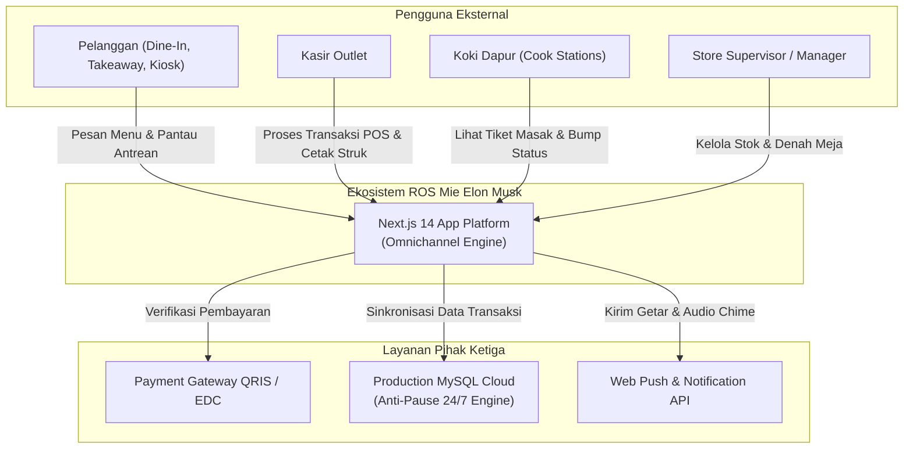
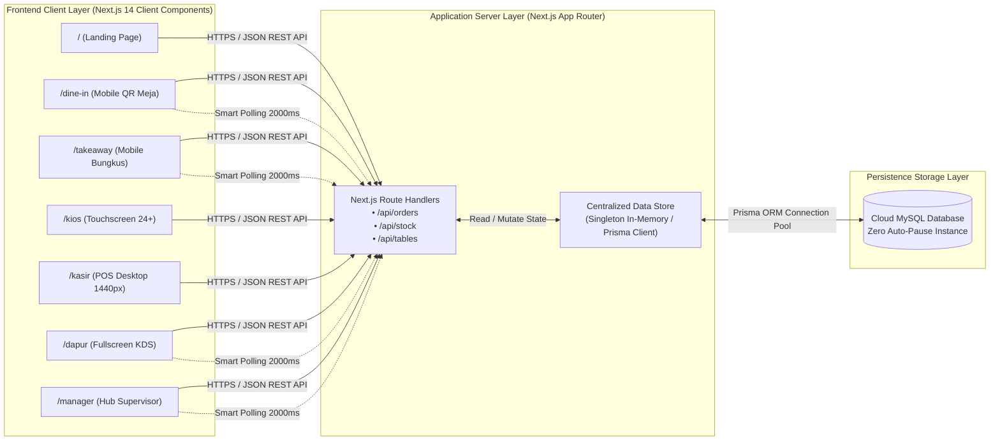
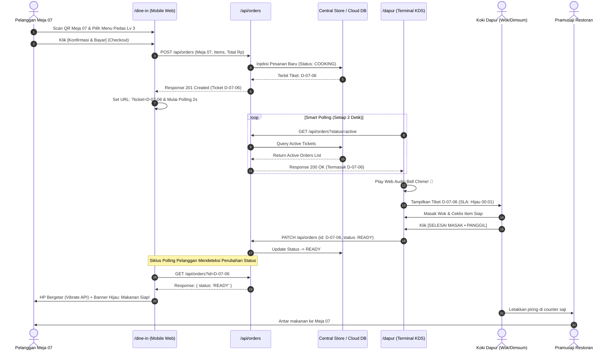
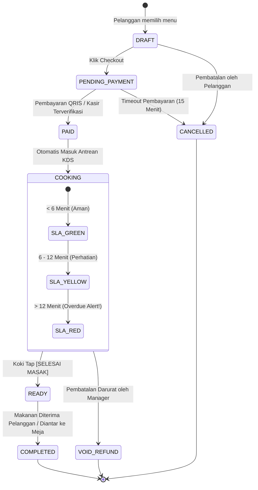

# SYSTEM ARCHITECTURE DOCUMENT (SAD)
## Omnichannel Restaurant Operating System (ROS) — Mie Elon Musk
**Document Code:** SAD-MEM-2026-V1.0  
**Version:** 1.0 (Production Architecture)  
**Author:** Principal Software Architect  
**Date:** 21 Oktober 2026  
**Status:** Approved Architecture Blueprint  

---

## 1. DESAIN ARSITEKTUR KONSEPTUAL (C4 MODEL)

### 1.1 C4 Level 1: System Context Diagram
Diagram ini memetakan bagaimana sistem Mie Elon Musk berinteraksi dengan pengguna eksternal dan sistem pihak ketiga:



---

### 1.2 C4 Level 2: Container Diagram
Diagram ini memperlihatkan aplikasi, server, database, dan protokol komunikasi yang bekerja di dalam sistem:



---

## 2. DIAGRAM URUTAN ALUR TRANSAKSI (SEQUENCE DIAGRAM)

Alur berikut menggambarkan siklus lengkap dari pemesanan di meja hingga makanan disajikan oleh pramusaji:



---

## 3. STATE MACHINE DIAGRAM (SIKLUS HIDUP PESANAN)

Setiap pesanan di seluruh channel tunduk pada *state transition* yang terkontrol dan tidak dapat dilewati secara acak:



---

## 4. ANALISIS TEKNOLOGI: SMART POLLING VS WEBSOCKET

Salah satu keputusan arsitektur kunci dalam sistem ini adalah penggunaan **Smart Polling 2000ms** dibanding WebSocket murni:

| Kriteria Evaluasi | WebSocket (Socket.io / Supabase Realtime) | Smart Polling 2 Detik (Next.js REST API) | Keputusan Arsitektur |
|---|---|---|---|
| **Ketergantungan Server** | Butuh server stateful / daemon Socket.io aktif 24/7. | Stateless HTTP, kompatibel 100% dengan serverless / Node.js standard. | **Smart Polling Menang** (Biaya hosting rendah). |
| **Koneksi Wi-Fi Restoran** | Rentan putus (socket drop) saat pergantian access point kru. | Sangat toleran; jika request gagal, retry otomatis di 2 detik berikutnya. | **Smart Polling Menang** (Reliabilitas operasional tinggi). |
| **Beban Jaringan (Bandwidth)** | Sangat kecil per frame. | Sangat ringan (~1.2 KB per payload JSON antrean aktif). | **Keduanya Sangat Baik**. |
| **Ketahanan Pause Cloud** | Terikat Supabase Realtime yang otomatis di-pause tiap 7 hari. | Menggunakan MySQL Cloud standar yang **bebas auto-pause seumur hidup**. | **Smart Polling Menang** (Zero downtime). |

---

## 5. STANDARDISASI IDENTIFIKASI TIKET OPERASIONAL

Format penomoran tiket distandardisasi dengan skema alfanumerik yang langsung terbaca oleh seluruh kru restoran:

```
┌───────────────────────────────────────────────────────────────┐
│              SKEMA NOMOR TIKET EKOSISTEM                     │
├───────────────┬─────────────────┬─────────────────────────────┤
│ Channel       │ Pola Penomoran  │ Contoh & Makna Lapangan     │
├───────────────┼─────────────────┼─────────────────────────────┤
│ Dine-In Meja  │ D-[Meja]-[Seq]  │ D-07-06 (Meja 07, Urutan 6) │
│ Takeaway      │ T-[Seq]         │ T-032 (Bungkus Urutan 32)   │
│ Kios Lobby    │ K-[Seq]         │ K-017 (Kios Mandiri 17)     │
│ Kasir Fisik   │ C-[Seq]         │ C-044 (Kasir Tunai 44)      │
└───────────────┴─────────────────┴─────────────────────────────┘
```
